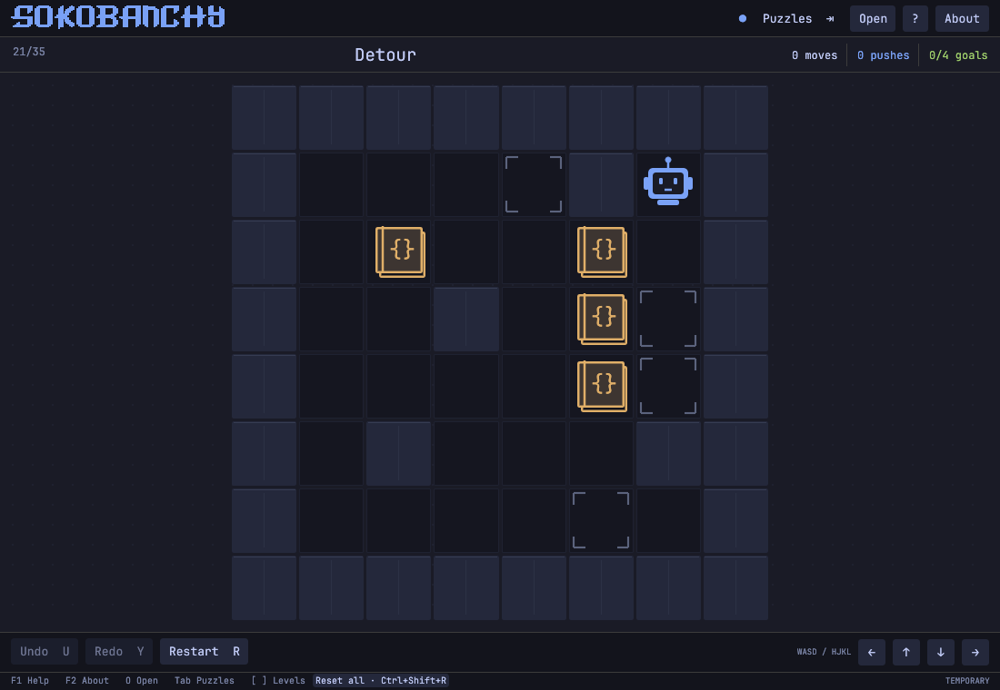
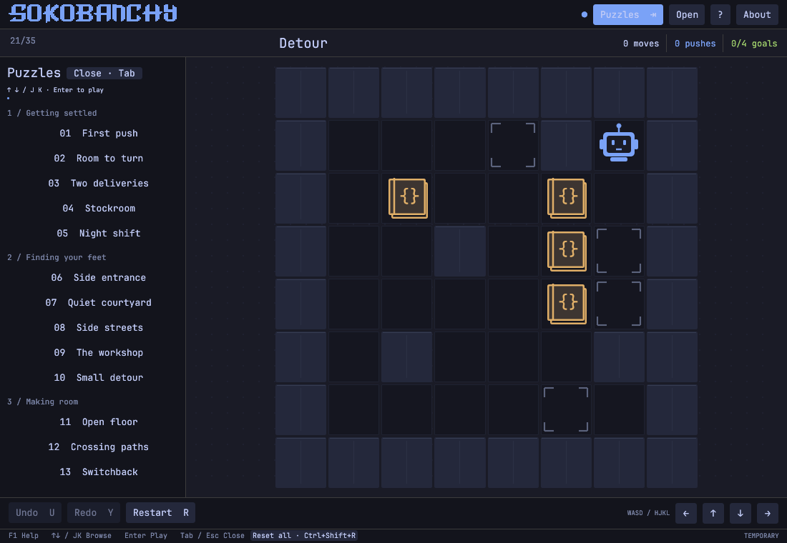
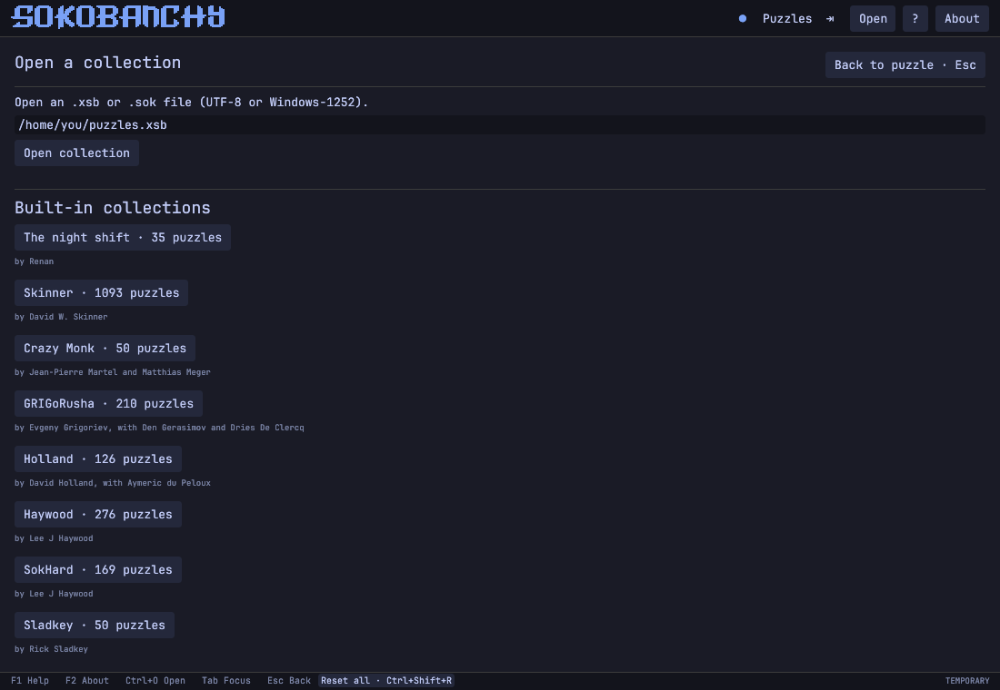
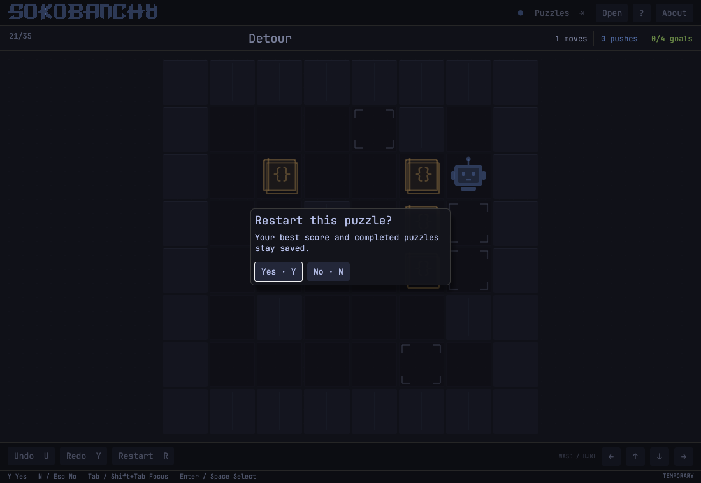
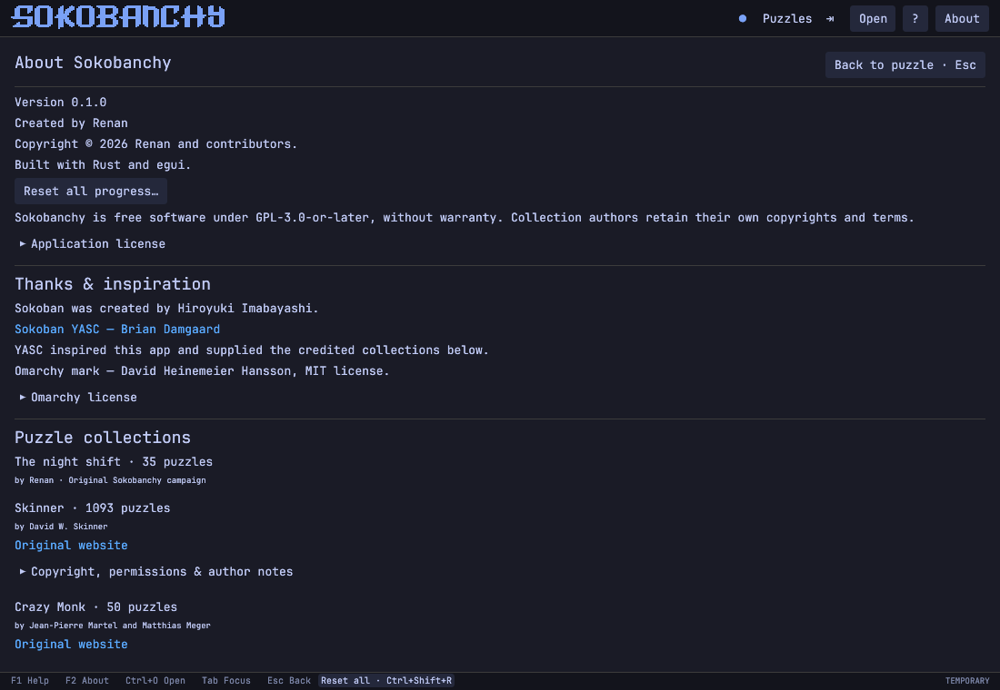

# Sokobanchy

A native Rust Sokoban game for Linux by **[Renan](https://github.com/renanmt)**, made to feel at home on Omarchy.

Guide an AI agent. Push code libraries into placeholders to create Omarchy logos. Take your time. Undo anything.



- One 35-puzzle original campaign, **The night shift**, combining both earlier collections without duplicate boards.
- Seven chapters ordered by verified minimum pushes; existing progress from both collections is preserved.
- A compact monospace interface and vector artwork colored by your desktop theme.
- A board-first layout: 880×680 default, usable down to 600×460; the puzzle list opens with Tab.
- Live Omarchy palettes, including light themes; standalone Tokyo Night fallback.
- Arrow, WASD, and Vim controls; clickable direction buttons; undo, redo, restart, and level selection.
- Automatic local progress, resumed moves, and best scores (fewest moves, then pushes). **Reset all** in the bottom bar (Ctrl+Shift+R) clears every puzzle and score after confirmation. Restart (R) affects only the current puzzle and preserves best scores.
- Eight credited community collections available through **Open**, plus external XSB and plain-text Sokoban files in UTF-8 or Windows-1252.
- An **About** page with Renan’s author credit, collection creators, permissions, and author notes.
- About, Help, Open, and reset-all confirmation occupy the main body, with persistent navigation and **Back to puzzle / Escape**. **Puzzles** opens a sidebar beside the board. Single-puzzle restart is the exception: a centered Yes/No dialog floats over the visible board.
- A persistent bottom bar shows keyboard shortcuts. **F1** opens Help and stays open when the key repeats; **Escape** returns to the puzzle.
- An Omarchy Quattro bar plugin that launches the same native game.

## Install on Omarchy Quattro

```sh
omarchy pkg add rust base-devel
omarchy plugin add https://github.com/renanmt/sokobanchy --enable
```

Click the crate in the bar to start playing. The first launch compiles the game and needs internet access for Rust dependencies. Later launches reuse the build cache. Marketplace submission is being prepared; the app is not yet listed.

## Screenshots

The puzzle sidebar stays beside the board:



Open the original campaign, a credited community collection, or your own collection file:



Restart the current puzzle with a centered Yes/No confirmation:



Credits and reset-all controls live inside the app:



These are captures of the actual egui interface in a fresh session, using the built-in Tokyo Night palette.

## Run from source

Rust 1.88 or newer, a C toolchain, and a Wayland or X11 desktop with OpenGL are required. On Omarchy, install build prerequisites if needed:

```sh
omarchy pkg add rust base-devel
cargo run --release --locked
```

The ordinary desktop runtime libraries are already present on Omarchy. On Debian/Ubuntu, a development machine also needs `build-essential pkg-config libxkbcommon-dev libwayland-dev libegl1-mesa-dev libgl1-mesa-dev`.

```sh
cargo run --release --locked -- --levels /path/to/collection.xsb
cargo run --release --locked -- --theme /path/to/colors.toml
cargo run --release --locked -- --fresh
```

`--fresh` is a temporary session: it neither reads nor writes progress. Use `--help` for all options.

## Install standalone

```sh
./scripts/install.sh
```

This builds the game and installs the binary to `~/.local/bin`, plus an application-menu entry and SVG icon under `${XDG_DATA_HOME:-~/.local/share}`. Start **Sokobanchy** from the application launcher or run `~/.local/bin/sokobanchy`. `PREFIX` overrides the binary prefix; no root access is needed.

```sh
./scripts/uninstall.sh
```

Uninstall removes only those three installed files. Saved progress and build caches are preserved.

## Omarchy plugin

The repository root is a Quattro plugin (`renan.sokobanchy`). The native game lives alongside its small QML bar launcher. Validate it with:

```sh
omarchy plugin validate .
```

The crate icon appears in the right bar section. Its first click builds the native game with Cargo and opens it. Install `rust` and `base-devel` beforehand. The first build needs internet access to download the locked Rust dependencies and may take a few minutes. Later clicks use Cargo's incremental check, including after plugin updates.

The plugin runs no build on activation. All generated files go to `${XDG_CACHE_HOME:-~/.cache}/sokobanchy`, outside the watched plugin checkout. A desktop notification reports first-build or build errors; diagnostics are in `build.log` in that cache directory. Multiple clicks during a build are serialized. The launcher does not download executables or request elevated privileges.

```sh
omarchy plugin disable renan.sokobanchy
omarchy plugin remove renan.sokobanchy
```

The standalone installation and the plugin are independent. Both use the same progress file. Avoid playing the same collection in multiple windows at once: the last saved window wins.

## Controls

| Action | Keys |
| --- | --- |
| Move / push | Arrows, WASD, HJKL |
| Undo | Ctrl+Z, U, or Z |
| Redo | Ctrl+Shift+Z, Ctrl+Y, or Y |
| Restart current puzzle | R, then Y (or Enter); N or Escape cancels |
| Reset all puzzles and scores | Ctrl+Shift+R, then Y; N or Escape cancels |
| Navigate reset confirmation | Tab / Shift+Tab, then Enter or Space; Cancel is focused first |
| Previous / next puzzle | `[` / `]` |
| Next puzzle after solving | Enter |
| Show / hide puzzle sidebar | Tab |
| Browse sidebar / open puzzle | Up/Down or J/K, then Enter |
| First / last puzzle in sidebar | Home / End |
| Jump 10 puzzles in sidebar | Page Up / Page Down |
| Open collection | O or Ctrl+O |
| Help / About | F1 / F2 |
| Focus controls on pages | Tab / Shift+Tab |
| Return to the puzzle | Escape |

Libraries cannot be pulled, and only one can be pushed at a time. Empty goals are hollow corner brackets. A yellow code library becomes a green Omarchy logo when pushed onto a goal; pushing it off restores the library and empty placeholder. Undo and redo restore the corresponding appearance too. The agent smiles briefly for each delivery and keeps smiling while the puzzle is complete. Distinct shapes identify each state as well as color. Corner warnings detect libraries trapped against perpendicular walls; they are not a complete deadlock solver.

## Original campaign

**The night shift** combines the former 20-puzzle campaign and 18-puzzle first collection into 35 unique puzzles. Their three shared introductory boards appear once. Both distinct boards formerly called **Last delivery** are retained; the earlier collection's board is now **Final rounds**. Board identities are unchanged, so existing progress follows each puzzle into its new position. All boards fit within 9×8 tiles.

Puzzles are sorted by proven minimum pushes, then by the extra pushes required beyond the independent crate-to-goal routing lower bound. Remaining ties retain their source order. This gives a measurable progression, though it cannot guarantee how difficult each person finds a puzzle.

| Chapter | Puzzles | Minimum pushes |
| --- | --- | --- |
| Getting settled | 1–5 | 1–6 |
| Finding your feet | 6–10 | 7–8 |
| Making room | 11–15 | 9 |
| Taking the long way | 16–20 | 11–12 |
| Traffic control | 21–25 | 13–16 |
| Night shift | 26–30 | 16–20 |
| Clocking out | 31–35 | 20–26 |

Later puzzles require up to 12 pushes beyond the independent routing lower bound: solving them involves moving things out of the way. Both a Rust push-BFS solver and an independent Python implementation verified all 35 minimum counts.

`assets/campaign.json` is the curated source, including provenance and solution witnesses (spoilers). `python3 scripts/generate-levels.py` reproduces the shipped campaign, chapter labels, and test paths. To recheck optimality:

```sh
cargo run --release --locked --example campaign_lab -- verify assets/levels.xsb
```

The offline design tool can also generate candidates with `generate` or `variations`. It reads no third-party collections. The game itself never runs a solver or generator.

## Themes and saves

The game checks the palette once per second and updates without restarting or installing hooks. Lookup order:

1. An explicit `--theme` file, when supplied.
2. `$XDG_STATE_HOME/omarchy/current/theme/colors.toml` (default `~/.local/state`), used by current Omarchy.
3. `$XDG_CONFIG_HOME/omarchy/current/theme/colors.toml` (default `~/.config`), used by older Omarchy installations.
4. Built-in Tokyo Night.

It reads semantic palette colors and supports legacy `color1`–`color4` accents. `mode = "light"` is supported; legacy light themes are inferred from background brightness. It never changes your theme or desktop settings. JetBrains Mono is used when installed, with an embedded monospace fallback.

Progress is saved after actions and level changes to `${XDG_STATE_HOME:-~/.local/state}/sokobanchy/progress.json`, using an atomic replacement. Board content identifies each record, so collections do not collide merely because their level numbers match. Completed records survive a restart of a puzzle. To erase all completions, best scores, saved moves, and undo/redo history across every collection, choose **Reset all** in the bottom bar or press **Ctrl+Shift+R**, then choose **Reset all puzzles and scores** or press **Y**. **N**, **Keep my progress**, or Escape cancels. Cancel receives keyboard focus first; Tab / Shift+Tab moves focus, and Enter / Space activates the focused button. The same action is also available in About. The current collection returns to its first puzzle with zero moves and pushes; collection files are preserved. In a `--fresh` session, reset affects only that temporary session. A failed save leaves existing progress intact. Undo history is reconstructed from saved moves; the redo branch lasts for the current session. A malformed existing save is preserved and saving is disabled for that session, with a visible error.

**Open** includes Skinner (1,093 puzzles), Crazy Monk (50), GRIGoRusha (210), Holland (126), Haywood (276), SokHard (169), Sladkey (50), and YASGen (10). Each label includes a small “by …” credit. The 1,984 entries preserve their source order and may overlap across collections. The original 35-puzzle campaign remains the default. **About** contains full credits and terms; see [the collection review](assets/collections/README.md) for inclusion decisions and permissions.

Imported collections accept UTF-8 and legacy Windows-1252 text and use the conventional `# @ $ . + *` characters and space, `-`, or `_` for floor. Text or semicolon titles before boards are supported. Boards must be enclosed, with one player and equal nonzero crate/goal counts; the maximum board size is 128×128. This is a board importer, not a reader for YASC saved games, solution metadata, binary files, or all format extensions. Reopen an imported collection to resume it; the default launch opens the bundled collection.

## Development and release

```sh
export CARGO_TARGET_DIR="${XDG_CACHE_HOME:-$HOME/.cache}/sokobanchy/target"
cargo fmt --all --check
cargo clippy --all-targets --locked -- -D warnings
cargo test --locked
omarchy plugin validate .
python3 scripts/check-manifest.py
./scripts/package.sh
```

`package.sh` builds a native release and creates a Linux architecture-specific archive under `dist/`. Build on the oldest Linux distribution you intend to support; binaries link to system libraries. The source build is the supported Omarchy marketplace installation path.

Tests replay every campaign solution, undo and redo its full history, verify the union of both original collections and restored progress, check campaign order and board identities, validate input and collision rules, round-trip progress, and check current/legacy themes. Headless UI checks cover board proportions at 600×460 through 880×680 and all main-body pages at both minimum and wide window sizes, including navigation and keyboard isolation. The original collections are retained only as regression fixtures under `tests/fixtures/`; `scripts/generate-first-collection.py` reproduces the earlier collection fixture. Community collection tests replay a supplied solution for every entry and verify that external source imports retain identical board IDs. `python3 scripts/generate-collections.py` rebuilds the embedded collections and credits from their reviewed source copies.

For reproducible app-only captures with Mesa EGL:

```sh
SOKOBANCHY_SCREENSHOT_DIR=/tmp/sokobanchy-screenshots LIBGL_ALWAYS_SOFTWARE=1 \
  cargo test --locked --bin sokobanchy capture_release_screenshots -- --ignored --nocapture
```

The screenshot test is skipped during ordinary tests and never reads or writes saved progress.

Before publishing, review [RELEASING.md](RELEASING.md) for the public repository, author identity, plugin validation, and marketplace submission steps. This project has not been submitted to the marketplace.

## Credits and license

Inspired by **Sokoban YASC — Yet Another Sokoban Clone**, by Brian Damgaard, whose source distribution provided the reference collections. Reference: <https://sourceforge.net/projects/sokobanyasc/>. The Rust implementation, original 35-puzzle campaign, agent, and library artwork were created for this project. Eight third-party collections are bundled with their own attribution and permission notices. YASC code, skins, and sounds are not bundled with releases. The text logo in `assets/logo.txt` is drawn directly from its block characters.

The completed-library mark reproduces the geometry of [Omarchy’s icon](https://github.com/omacom/omarchy/blob/master/icon.png), recolored with the active palette. Omarchy is copyright David Heinemeier Hansson; its MIT notice is included in [assets/OMARCHY-LICENSE](assets/OMARCHY-LICENSE).

GPL-3.0-or-later; see [LICENSE](LICENSE). Rust dependencies retain their respective licenses. See [NOTICE](NOTICE).

The `shared/` directory is reference material and excluded from Git, Cargo packages, and release archives. Its Delphi `.dfm` files can be incorrectly detected as JPEG XL on Linux. Preserve the originals; inspect as data/text only. Never thumbnail or image-decode `.dfm` files, and never open this reference directory in a graphical file browser.
